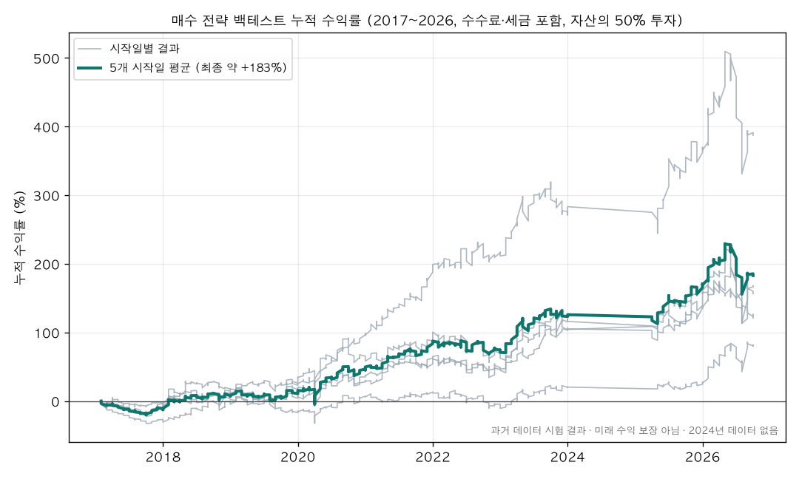

# 매매 전략 백테스트 검증 보고서

국내 주식 시장 데이터를 자동으로 수집하고, 매매 전략을 과거 데이터로 검증하는 시스템의 **검증 과정과 결과**를 정리한 공개 보고서입니다.
자체 프로젝트이며, 2026년 5월부터 LLM 기반 개발 도구를 활용해 개발하고 있습니다. 코드와 전략의 세부 규칙은 공개하지 않습니다.

## 결과 요약

| 항목 | 값 |
|---|---|
| 기간 | 2017 ~ 2026 (2024년은 데이터 없음) |
| 방식 | 매수 전략, 자산의 50% 투자 |
| 누적 수익률 (시작일 5가지 평균) | 약 **+183%** |
| 시작일에 따른 범위 | 약 +80% ~ +387% |
| 최대 하락 (일별) | 약 −34% |
| 비용 | 매매 수수료와 거래세 포함 |

> 과거 데이터로 시험한 결과이며, 미래 수익을 보장하지 않습니다.

## 어떻게 검증했나

1. **미래 정보 차단:** 해마다 그 이전 데이터로만 학습하고, 다음 해를 시험했습니다.
2. **외부 엔진 교차 검증:** 공개 백테스트 엔진(bt, MIT 라이선스)으로 같은 결과를 처음부터 다시 계산했습니다. 6개 전략 모두 0.4% 이내로 일치했습니다.
3. **결함 발견과 수정:** 거래정지·상장폐지 종목이 후보에서 빠지던 결함을 찾아 고친 뒤 다시 계산했습니다. 결과는 수정 전과 비슷한 범위였습니다.
4. **선택 편향 보정:** 여러 후보 중 가장 좋은 것을 고를 때 생기는 운의 몫을 공개 통계 방법으로 보정했습니다.
   - Deflated Sharpe Ratio: 약 0.96 (기준 0.95)
   - 과적합 확률(PBO): 6~10%
5. **시작일 운 점검:** 같은 전략을 5가지 시작일로 모두 돌려, 가장 좋은 경우가 아니라 **평균**을 기준으로 삼았습니다.

## 시험했지만 채택하지 않은 방법

모두 결과를 보기 전에 합격 기준을 정해 두고 시험했습니다. 기준을 넘지 못해 쓰지 않았습니다.

- 지수 인버스 상품으로 시장 하락 방어
- 종목 수를 늘려 분산
- 시작일을 나눠 분할 매수
- 뉴스 분위기(악재 신호)로 진입 조절
- 같은 방법을 가상화폐에 적용

## 안전장치

- 거래 API 키는 운영체제 금고에만 보관하고, 코드·로그·화면에 남기지 않습니다.
- 손실 한도에 도달하면 주문을 자동으로 차단합니다. 차단은 오프라인 시험으로 확인했습니다.
- 모든 외부 호출은 대상·횟수·목적을 미리 정한 범위 안에서만 실행하고 기록합니다.

## 개발 방식

- 자동 시험 약 4,600개, 모든 변경에 자동 검사와 독립 리뷰를 적용합니다.
- 품질 지표(위험 코드 수, 정적 분석 경고 등)가 나빠지는 변경은 받지 않는 방식(ratchet)을 씁니다.

## 한계

- 과거 데이터 시험이며, 실거래 기록은 이제 쌓기 시작하는 단계입니다.
- 2015~2023년 데이터는 외부 인증을 받지 않은 연구용 데이터입니다.

---

### English summary
Backtest validation report for a self-built market-data and strategy-validation system (2026-05 onward, built with LLM-assisted development tools). Buy-only strategy, 50% of capital, 2017–2026 (2024 missing), fees and taxes included:
- Cumulative return averaged over five start dates: about **+183%** (range +80% to +387%).
- Maximum daily drawdown: about −34%.

Validation steps:
- Walk-forward training only, so no future information is used.
- An independent re-computation with the open-source `bt` engine matched within 0.4%.
- A candidate-selection defect was fixed.
- Selection bias was corrected (Deflated Sharpe ≈ 0.96, PBO 6–10%).

Several pre-registered drawdown defences failed and were not adopted. Past results do not guarantee future returns. Code and strategy rules are not published.
